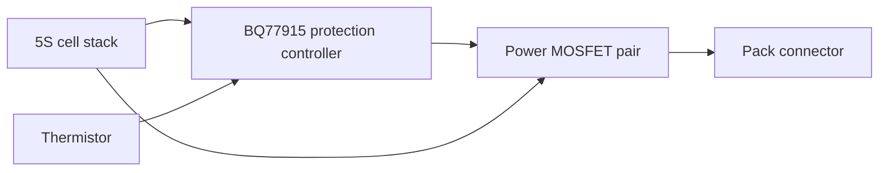

# BP5S - five-cell battery protector

> **AI use.** The authors use AI for additional validation, component research, testbench setup and simulation, intermediate design reviews, release setup, and assistance with KiCad and 3D model edits. The authors developed the original designs and schematics manually, and other people reviewed them. The authors make the technical and visual decisions and take responsibility for them.

Project has been manufactured and tested at real hardware.
BP5S provides a dedicated protection board for a five-series-cell battery pack, but not a charging or any kind of switching cictuit.

## Nominal characteristics

| Characteristic | Rev1 design value |
| --- | --- |
| Battery configuration | 5 series Li-ion cells, 18.0–18.5 V nominal at 3.6–3.7 V per cell |
| Cell overvoltage and undervoltage trips | 4.20 V and 2.90 V per cell, respectively, with a nominal 1 s detection delay |
| Charge overcurrent trip | 6 A nominal, 10 ms detection delay |
| Discharge overcurrent trip | 6 A nominal, 180 ms detection delay |
| Discharge short-circuit trip | 12 A nominal, 960 µs detection delay |
| Temperature sensing | External 10 kΩ NTC on TH1. With a 103AT thermistor, nominal low/high trips are 0 °C / 45 °C for charge and −10 °C / 65 °C for discharge |
| Cell balancing | Passive balancing during charge, with a 3.80 V per-cell start threshold and a 50 mA limit for the controller’s internal balancing path |
| Connections | BATT− and BATT+ pads, four intermediate cell taps on J3, and an XT60 pack connector on J6 |

## Goals and architecture

Keep cell monitoring and pack protection on a compact board, with a thermistor input and a high-current pack connection. The BQ7791500PWR monitors the cell stack and controls two CSD18534Q5A power MOSFETs. Input filtering, transient protection, and the temperature-sense network support the protection stage; the pack connection uses an XT60 connector.

## rev1

Rev1 has been manufactured and tested at real hardware [Rev1 release](https://github.com/Coestaris/hw-bp5s/releases/tag/rev1)

Top and bottom views

| File | Download |
| --- | --- |
| Schematic PDF | [bp5s-schematic.pdf](https://github.com/Coestaris/hw-bp5s/releases/download/rev1/bp5s-schematic.pdf) |
| PCB PDF | [bp5s-pcb.pdf](https://github.com/Coestaris/hw-bp5s/releases/download/rev1/bp5s-pcb.pdf) |
| Gerbers and drill files | [bp5s-gerbers.zip](https://github.com/Coestaris/hw-bp5s/releases/download/rev1/bp5s-gerbers.zip) |
| JLCPCB BOM | [bp5s-jlcpcb-bom.csv](https://github.com/Coestaris/hw-bp5s/releases/download/rev1/bp5s-jlcpcb-bom.csv) |
| JLCPCB placement | [bp5s-jlcpcb-pnp.csv](https://github.com/Coestaris/hw-bp5s/releases/download/rev1/bp5s-jlcpcb-pnp.csv) |
| 3D assembly model | [bp5s.stpz](https://github.com/Coestaris/hw-bp5s/releases/download/rev1/bp5s.stpz) |
