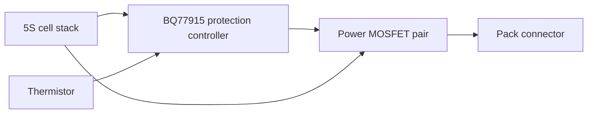

# BP5S — five-cell battery protector

Manufactured hardware, revision 1. BP5S provides a dedicated protection board for a five-series-cell battery pack.

## Goals and architecture

Keep cell monitoring and pack protection on a compact board, with a thermistor input and a high-current pack connection. The BQ7791500PWR monitors the cell stack and controls two CSD18534Q5A power MOSFETs. Input filtering, transient protection, and the temperature-sense network support the protection stage; the pack connection uses an XT60 connector.

## Design files

- [KiCad 10 project](hardware/rev1/bp5s.kicad_pro), [schematic](hardware/rev1/bp5s.kicad_sch), and [PCB](hardware/rev1/bp5s.kicad_pcb)
- [Revision notes](hardware/rev1/README.md) and [test plan](hardware/rev1/test-plan.html)
- Project-owned component models, datasheets, and review evidence in [assets](assets/)

## Working with the design

Clone this repository and run `git lfs pull` before opening the KiCad project. The native design and its required assets are included here. Maintainer automation uses the pinned private `infra` submodule; see [development and release tooling](docs/development.md).
