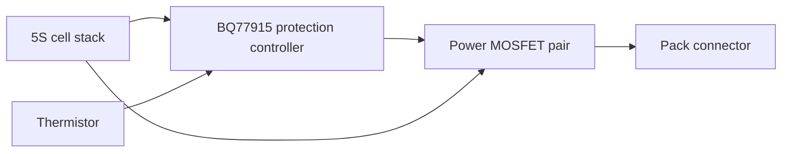

# BP5S — five-cell battery protector

Manufactured hardware, revision 1. BP5S provides a dedicated protection board for a five-series-cell battery pack.

## Goals and architecture

Keep cell monitoring and pack protection on a compact board, with a thermistor input and a high-current pack connection. The BQ7791500PWR monitors the cell stack and controls two CSD18534Q5A power MOSFETs. Input filtering, transient protection, and the temperature-sense network support the protection stage; the pack connection uses an XT60 connector.

## Design files

- [KiCad 10 project](hardware/rev1/bp5s.kicad_pro), [schematic](hardware/rev1/bp5s.kicad_sch), and [PCB](hardware/rev1/bp5s.kicad_pcb)
- [Bench test plan](hardware/rev1/test-plan.html)
- Project-owned component models, datasheets, and review evidence in [assets](assets/)

## Working with the design

Clone this repository and run `git lfs pull` before opening the KiCad project. The native design and its required assets are included here. Maintainer automation uses the pinned private `infra` submodule.

## Board renders and releases

### Rev1

[Published rev1 release](https://github.com/Coestaris/hw-bp5s/releases/tag/rev1). The release workflow passed the complete gate and manufacturing export.

Top and bottom views

| File | Download |
| --- | --- |
| Schematic PDF | [bp5s-schematic.pdf](https://github.com/Coestaris/hw-bp5s/releases/download/rev1/bp5s-schematic.pdf) |
| PCB PDF | [bp5s-pcb.pdf](https://github.com/Coestaris/hw-bp5s/releases/download/rev1/bp5s-pcb.pdf) |
| Gerbers and drill files | [bp5s-gerbers.zip](https://github.com/Coestaris/hw-bp5s/releases/download/rev1/bp5s-gerbers.zip) |
| JLCPCB BOM | [bp5s-jlcpcb-bom.csv](https://github.com/Coestaris/hw-bp5s/releases/download/rev1/bp5s-jlcpcb-bom.csv) |
| JLCPCB placement | [bp5s-jlcpcb-pnp.csv](https://github.com/Coestaris/hw-bp5s/releases/download/rev1/bp5s-jlcpcb-pnp.csv) |
| 3D assembly model | [bp5s.stpz](https://github.com/Coestaris/hw-bp5s/releases/download/rev1/bp5s.stpz) |
