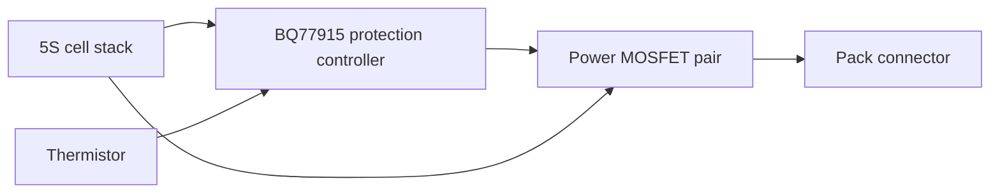

# BP5S — five-cell battery protector

Rev1 has been manufactured. BP5S provides a dedicated protection board for a five-series-cell battery pack.

> **AI use.** The authors use AI for component research, design validation, and release preparation. The authors make the technical and visual decisions and take responsibility for them.

## Goals and architecture

Keep cell monitoring and pack protection on a compact board, with a thermistor input and a high-current pack connection. The BQ7791500PWR monitors the cell stack and controls two CSD18534Q5A power MOSFETs. Input filtering, transient protection, and the temperature-sense network support the protection stage; the pack connection uses an XT60 connector.

## Hardware projects

| Board | Purpose | Design | Simulation |
| --- | --- | --- | --- |
| rev1 | Five-cell pack protection | [KiCad project](hardware/rev1/bp5s.kicad_pro), [bench test plan](hardware/rev1/test-plan.html) | — |

### rev1 - five-cell pack protection

Rev1 monitors a five-series-cell stack and controls the pack connection through a pair of power MOSFETs. [Rev1 release](https://github.com/Coestaris/hw-bp5s/releases/tag/rev1)

Top and bottom views

| File | Download |
| --- | --- |
| Schematic PDF | [bp5s-schematic.pdf](https://github.com/Coestaris/hw-bp5s/releases/download/rev1/bp5s-schematic.pdf) |
| PCB PDF | [bp5s-pcb.pdf](https://github.com/Coestaris/hw-bp5s/releases/download/rev1/bp5s-pcb.pdf) |
| Gerbers and drill files | [bp5s-gerbers.zip](https://github.com/Coestaris/hw-bp5s/releases/download/rev1/bp5s-gerbers.zip) |
| JLCPCB BOM | [bp5s-jlcpcb-bom.csv](https://github.com/Coestaris/hw-bp5s/releases/download/rev1/bp5s-jlcpcb-bom.csv) |
| JLCPCB placement | [bp5s-jlcpcb-pnp.csv](https://github.com/Coestaris/hw-bp5s/releases/download/rev1/bp5s-jlcpcb-pnp.csv) |
| 3D assembly model | [bp5s.stpz](https://github.com/Coestaris/hw-bp5s/releases/download/rev1/bp5s.stpz) |
